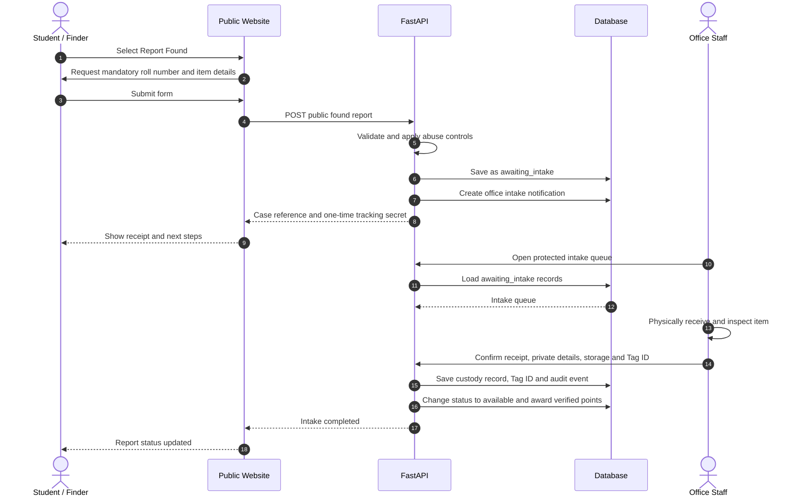
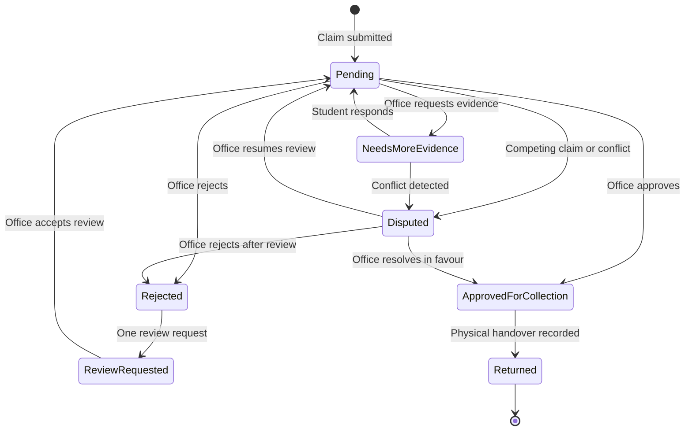

# LostLink Public Student Workflow — CVR College of Engineering

## 1. Product decision

LostLink is a public campus lost-and-found website for CVR College of Engineering.

- Students do not create accounts, sign in, set passwords, or maintain student browser sessions.
- A student must enter a CVR roll number when submitting a lost report, found report, or ownership claim.
- The roll number is a private attribution field, not authentication. Knowing another student's roll number must never grant access to that student's reports, claims, evidence, notifications, or activity.
- Public browsing exposes only office-approved found-item information.
- Office staff retain a separate authenticated, role-restricted console.
- Physical custody, ownership decisions and item release remain human office responsibilities. AI matching is advisory only.

This is the target product workflow. The current repository still has session-authenticated student endpoints and user foreign keys; this document does not claim that the backend has already been migrated. Section 10 defines the required migration.

## 2. Roles and trust boundaries

| Actor | Access |
|---|---|
| Public visitor / student | View landing page, browse available found items, submit lost/found reports with mandatory roll number, submit claims, and access an individual case using a private tracking credential. |
| Campus office staff | Sign in through the staff-only route; confirm found-item intake, set custody location and Tag ID, review private claim evidence, decide claims, and record physical handover. |
| LostLink application | Validate payloads, persist records, rank possible matches, issue tracking credentials, enforce visibility, notify users and write audit events. |
| Database and private object storage | Store student identifiers, case records, private evidence and staff-only custody information behind server-side access controls. |

**Trust rule:** Roll number is a student-provided identifier. It must never be accepted as proof of identity or used alone to retrieve private case data.

## 3. Student-facing page map

The public website must be one coherent website with real view/route transitions, not a landing page followed by a second page appended beneath it.

1. **Home** — explains LostLink and offers Report Lost, Report Found, and Browse Found Items.
2. **Report Lost / Report Found** — one shared form with report type preselected. Mandatory student roll number appears first.
3. **Browse Found Items** — searchable cards containing only public, office-approved information.
4. **Item Details** — public description, public reference and Claim this item action. No Tag ID, private intake notes, exact custody shelf, claimant identity, or private image.
5. **Submit Claim** — mandatory roll number, private ownership explanation, evidence checklist and optional private evidence image.
6. **Case Receipt** — public reference plus a high-entropy tracking code shown once. Explain that the code must be saved.
7. **Track a Case** — opens or accepts the private receipt link. No separate tracking-secret field is shown; roll number remains attribution, not authentication.
8. **Office Console** — separate staff login and protected routes.

The public student workflow has no student dashboard session. A student's cases are accessed using the case receipt credential. A future institutional identity provider can replace this mechanism without changing the case lifecycle.

## 4. End-to-end workflow

### A. Lost-item report

1. Student opens Home and selects Report Lost.
2. The report form opens as a real view/route; it does not render below Home.
3. Student enters mandatory CVR roll number and item details: item name, category, description, last-seen date/time and campus location. Brand, colour, visible features and photo are optional.
4. Client-side validation gives immediate feedback; the server repeats every validation.
5. Server normalises the roll number, validates field limits, applies abuse controls and stores the report with open status.
6. Server generates a non-guessable case tracking credential and returns the public reference plus a private receipt link; the interface does not ask the student to type a separate secret.
7. An optional photo is uploaded through the same image validation, normalisation and duplicate-detection pipeline used by the existing application.
8. Matching service compares the lost report with available found inventory using text, category, location, time and optional CLIP image signals.
9. Possible matches and their explanations are displayed as leads. A student can open a found item and submit a claim; similarity never approves ownership.
10. Student opens or pastes the private receipt link to track status and view permitted case information.

### B. Found-item report and physical intake

1. Student selects Report Found and enters mandatory roll number plus item description, discovery time and location.
2. Server stores the report as awaiting_intake; it is not added to public found-item search.
3. Office staff receive an intake task.
4. Staff physically receive the item, inspect it, record private distinguishing details, sensitivity level and actual storage location, and assign a physical LostLink Tag ID.
5. Staff confirm intake. The server changes the report to available, records an audit event and awards eligible verified-contribution points to the reporting roll number.
6. Only the public-safe projection becomes searchable. Private intake details, Tag ID and exact storage location remain staff-only.

### C. Claim and return

1. Student opens an available found-item card and chooses Claim.
2. Student supplies mandatory roll number, a private explanation and one or more evidence types. Optional evidence image is stored privately.
3. Server creates a claim in pending. If another active claim exists, all competing claims move to disputed and the item is held.
4. Server returns a claim reference and a separate high-entropy tracking credential. The student can use it to check status or provide requested additional evidence.
5. Office staff review the claim, compare evidence with private intake details and perform the institution's identity check.
6. Staff choose approve, reject, request more evidence, or mark disputed. The decision and rationale are audited.
7. Approval only authorises collection; it does not mark the item returned.
8. At the office desk, staff retrieve the physical item from its recorded location, compare the physical Tag ID, check claimant identity in person and confirm actual handover.
9. Server records handover, marks the item returned, closes relevant workflow records, sends the final notification and awards eligible return points.
10. Tracking credentials may be revoked after the approved retention period; audit records follow the institution's retention policy.

## 5. Sequence diagram — lost report to verified return

```mermaid
sequenceDiagram
    autonumber
    actor Student
    participant Web as Public LostLink Website
    participant API as FastAPI
    participant DB as Database
    participant Match as Matching Service
    actor Office as Campus Office Staff
    participant Store as Private Image Storage

    Student->>Web: Open Home
    Student->>Web: Select Report Lost
    Web->>Student: Show form with mandatory roll number
    Student->>Web: Submit roll number and item details
    Web->>API: POST public lost report
    API->>API: Validate fields, roll number and abuse limits
    API->>DB: Insert open lost report
    API->>API: Generate case reference and tracking secret
    API->>Match: Find available found-item candidates
    Match->>DB: Read public-safe available found records
    Match-->>API: Ranked candidates and explanations
    API-->>Web: Receipt, tracking secret and possible matches
    Web-->>Student: Show receipt once; prompt to save secret

    Student->>Web: Open candidate and choose Claim
    Web->>Student: Ask roll number and private ownership evidence
    Student->>Web: Submit claim and optional evidence image
    Web->>API: POST public claim
    API->>DB: Validate candidate and create pending claim
    opt Evidence image supplied
        API->>Store: Store private evidence image
        Store-->>API: Private object key
        API->>DB: Attach private evidence metadata
    end
    alt Competing active claim exists
        API->>DB: Put active claims into disputed state
        API-->>Web: Claim receipt; item held for review
    else No competing claim
        API-->>Web: Claim receipt; pending office review
    end
    Web-->>Student: Show claim reference and tracking secret

    Office->>Web: Staff sign in
    Web->>API: Authenticated office request
    API->>DB: Load office queue and private evidence
    DB-->>API: Claim and protected intake details
    API-->>Web: Staff-only review screen
    Office->>Web: Review evidence and identity-check process
    Office->>API: Approve, reject, request evidence or dispute
    API->>DB: Persist decision and audit event
    API-->>Web: Decision recorded
    Web-->>Student: Case status via tracking credential

    opt Claim approved
        Student->>Office: Attend campus office
        Office->>DB: Retrieve custody location and Tag ID
        Office->>Office: Retrieve item and compare physical Tag ID
        Office->>Office: Check claimant identity in person
        Office->>API: Confirm physical handover
        API->>DB: Record handover, returned status, audit and reward
        API-->>Web: Handover receipt
        Web-->>Student: Return confirmed
    end
```

## 6. Sequence diagram — found item intake



## 7. State machines

### Report state

```mermaid
stateDiagram-v2
    [*] --> Open: Lost report submitted
    [*] --> AwaitingIntake: Found report submitted
    AwaitingIntake --> Available: Office confirms physical receipt
    AwaitingIntake --> Cancelled: Finder withdraws before intake
    Open --> Closed: Student closes search
    Open --> Returned: Verified linked handover
    Available --> ReservedForReview: Claim submitted
    ReservedForReview --> Available: Claim rejected or withdrawn; no active claim
    ReservedForReview --> ApprovedForCollection: Office approves claim
    ReservedForReview --> Disputed: Competing claims or dispute
    Disputed --> ApprovedForCollection: Office resolves and approves
    Disputed --> Available: All claims resolved without approval
    ApprovedForCollection --> Returned: Physical handover confirmed
    Available --> Closed: Office closes item under policy
    Returned --> [*]
    Closed --> [*]
    Cancelled --> [*]
```



### Claim state



The implementation may retain its existing database status vocabulary where equivalent. Do not introduce a new status without a migration and tests. The state diagram is the domain contract; implementation mappings must be documented.

## 8. Public API contract to implement

The following is the target API shape, not a statement that these endpoints are already present.

| Method | Target path | Purpose | Access |
|---|---|---|---|
| GET | /api/public/config | Categories and approved campus locations | Public |
| GET | /api/public/found-items | Search available public found-item projections | Public, rate-limited |
| GET | /api/public/found-items/{public_ref} | Read one public-safe item | Public, rate-limited |
| POST | /api/public/reports | Submit lost/found report with mandatory roll number | Public, rate-limited, abuse-protected |
| POST | /api/public/reports/{public_ref}/tracking | Exchange case reference and tracking secret for minimal case status | Public, rate-limited |
| POST | /api/public/claims | Submit claim with roll number and private evidence | Public, rate-limited, abuse-protected |
| POST | /api/public/claims/{claim_ref}/tracking | Retrieve minimal claim status using claim tracking secret | Public, rate-limited |
| POST | /api/public/claims/{claim_ref}/evidence | Add requested evidence after tracking-secret verification | Public, rate-limited |
| POST | /api/office/auth/login | Office staff authentication | Staff only |
| GET | /api/office/intake | Found-item intake queue | Staff only |
| POST | /api/office/reports/{id}/intake | Confirm physical receipt, custody and Tag ID | Staff only |
| GET | /api/office/claims | Private claim review queue | Staff only |
| POST | /api/office/claims/{id}/decision | Record claim decision | Staff only |
| POST | /api/office/claims/{id}/handover | Record verified physical handover | Staff only |

## 9. Security, privacy and abuse controls

1. **Tracking secret:** Generate at least 128 bits of cryptographically random entropy; store only a strong hash. Show the secret once. Never derive it from roll number, public reference or report ID.
2. **Roll number:** Normalise and validate format, but do not claim it is verified against the college roster unless an approved roster integration exists. Avoid exposing roll numbers in public cards, URLs, logs and notifications.
3. **Case access:** Require the opaque tracking secret for private status, editing, claim follow-up and personal history. A roll number alone must return no private information.
4. **Public listing:** Return a purpose-built allowlist projection. Exclude roll number, contact details, private evidence, private intake notes, Tag ID, exact storage location, claimant data and sensitive item attributes.
5. **Sensitive categories:** Identity documents, keys/access credentials, cash and jewellery need stricter listing and image rules. Do not display sensitive item photos publicly.
6. **Claims:** Ownership explanations and evidence images are private to authorised staff and the claimant's tracking credential. Never place private evidence in public found-item endpoints.
7. **Office:** Staff authentication, role checks and session controls remain mandatory. Public student routes cannot call office operations.
8. **Abuse:** Rate-limit report, claim, search and tracking endpoints; add CAPTCHA or equivalent friction when abuse thresholds are reached; enforce payload and upload limits; deduplicate image uploads; apply idempotency keys to submissions.
9. **Audit:** Record report creation, intake, custody changes, claim decisions, evidence access where appropriate, and handover. Do not log raw tracking secrets or private evidence.
10. **Privacy by design:** Publish a retention notice and provide a college-approved process for correcting/removing student-submitted personal data.

## 10. Implementation migration plan

The repository currently implements student login/session dependencies and user-linked records. The target public model requires a deliberate backend migration. Do not simply remove authenticated_user from existing routes.

| Priority | Work | Acceptance condition |
|---|---|---|
| P0 | Define student identity model: roll number stored as private attribution, no student account/password required | Public report schema requires roll number; student flows need no student login API |
| P0 | Add opaque case/claim tracking credentials and hash storage | A case can be tracked only with its secret; roll number alone cannot retrieve it |
| P0 | Introduce public report and claim endpoints | Lost/found reports and claims persist without a student session |
| P0 | Separate public response serializers from office serializers | Public APIs cannot return roll number, Tag ID, custody, private notes or evidence |
| P0 | Keep office authentication isolated | Office intake, decisions and handover reject unauthenticated/non-office requests |
| P1 | Rework ownership relationships | Reports/claims no longer require a student login user foreign key; preserve office actor IDs and historical data |
| P1 | Add public case receipt and tracking UI | Student can save reference/secret and safely revisit a case |
| P1 | Add report/claim abuse controls | Rate limits, idempotency, upload validation and generic tracking failures are tested |
| P1 | Migrate notifications and rewards | Notifications/points associate with private roll number or student record without exposing it |
| P1 | Update mobile navigation and view routing | Each nav action replaces current view; no appended page or horizontal overflow at 320px–430px |
| P2 | Add approved student roster validation if college supplies a secure source | Validation is explicit, monitored and never inferred from roll-number shape alone |
| P2 | Add deployment controls and retention operations | HTTPS, private object storage, backups, retention and security review complete |

### Definition of done for the public student flow

- No student email/password sign-in or student session is required.
- Roll number is mandatory for every student-originated report and claim.
- Student can submit a lost report and receive a receipt.
- Student can submit a found report and see that it awaits office intake.
- Found reports are not public until physical intake is confirmed.
- Student can browse only available, public-safe found items.
- Student can submit a claim and follow it with a tracking secret.
- Competing claims are held for office review.
- Only authenticated office staff can view private evidence, assign Tag IDs, approve claims or record handover.
- Physical return is recorded separately from claim approval.
- Mobile layouts and navigation pass real viewport tests.

## 11. Critical implementation note

The current frontend's enterPublicPreview() creates a mock student session and enters the existing authenticated student application. That is a demo bridge, not the desired production student journey. It should be retired after the public report/claim/tracking endpoints and views are implemented. Office login remains separate and protected.

Do not ship a public website that accepts roll numbers but silently routes students into a mock user, or uses roll number as a password substitute.
